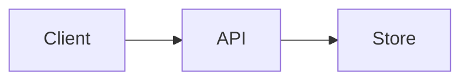

# Visuals

Read this in step 3 to choose a visual, and in step 4 to capture it. Use the real product with realistic data. Never invent a screenshot.

Last checked 2026-11-06. Commands come from each tool's own README and were not run during the research. Run `--help` first, because tools change.

## Choice order

Pick the first kind that shows the project working. This order is opinion:

1. Runnable text. A code sample is copyable, searchable and accessible.
2. Static screenshot.
3. SVG, or a cast with a linked player.
4. GIF, only when motion is the point.

| Type | Lead visual | Fallback |
|---|---|---|
| `library`, `sdk` | Code sample | None needed. `sdk` exemplars carried 0 or 1 images |
| `cli` | Terminal screenshot or GIF | Code fence with real output |
| `webapp` | Screenshot | Architecture diagram |
| `framework`, `monorepo` | Logo with theme support | Title only |
| `ml`, `research` | Key result or paper figure | Model diagram |
| `infra` | Architecture diagram | None, usage block first |
| `mobile` | Store screenshots, compressed | App icon |
| `desktop` | Screenshot or GIF | Screenshot section lower down |
| `game` | Gameplay screenshot | Logo. OpenTTD has no images, a gap for a visual product |
| `action` | None, pinned `uses:` example first | Workflow screenshot |
| `plugin` | Demo | None. `prettier-vscode` has no non-badge images, which also avoids Marketplace SVG limits |
| `design-system` | Component preview | Open Graph image |
| `docs` | Cover | None |
| `dotfiles` | Prompt screenshot | None |
| `awesome-list` | Logo, optional | None |
| `profile` | Banner | None. See [profile.md](profile.md) |
| `template` | Feature list | None |

In the 69 exemplars, GIF appeared in 5, `<picture>` in 13, Mermaid in 0 and `<video>` in 0. A hero image is a choice, not a requirement.

## Before any capture

- Use a clean account or demo data. Check for tokens, email addresses, private paths, customer data and internal hostnames.
- Set a consistent window size, zoom and theme.
- Close notifications and unrelated tabs.
- Open every file you made and look at it. Crop or redo anything that shows private data.

## Screenshot

- Capture the real window at 2x where the tool allows it, then scale so text stays readable at column width. The sharpness target is opinion.
- Crop to what the sentence on the first screen promises. Remove browser chrome unless the address bar matters.
- Save UI shots as PNG. Save photos and gameplay as JPEG or WebP if they compress better.
- For a page with a light and a dark mode, capture both and use `<picture>`.

For terminal output as an image:

```text
termshot --filename docs/ls.png -- "ls -a"
freeze --execute "eza -lah" --output docs/ls.png
freeze main.go --output docs/main.svg
```

[carbon](https://github.com/carbon-app/carbon) is a web tool for code images. Prefer real code text unless the image carries something text cannot.

## Terminal GIF with VHS

[VHS](https://github.com/charmbracelet/vhs) scripts a demo in a `.tape` file, so the demo can be rebuilt. Commit the tape beside the output. Gum records one per command this way.

```text
vhs new demo.tape
```

```text
Output docs/demo.gif
Set FontSize 32
Set Width 1200
Set Height 600
Type "tool run --sample"
Sleep 500ms
Enter
Sleep 3s
```

```text
vhs demo.tape
```

Keep the tape under 15 seconds and end on the result. That length is opinion.

## asciinema cast

[asciinema](https://github.com/asciinema/asciinema) records real terminal sessions. Use it when a scripted demo cannot reproduce the run.

```text
asciinema rec demo.cast
agg --idle-time-limit 1 --font-size 20 demo.cast docs/demo.gif
```

[agg](https://github.com/asciinema/agg) converts a cast to a GIF. asciinema's own README embeds an SVG preview that links to the hosted player, which avoids a large GIF. That needs the cast published on a host, which is the owner's call. Read a cast before sharing it, because it records everything typed.

`svg-term-cli` converts casts to SVG but has had no push since 2024.

## Screen recording and GIF

Record a short clip of one action. Then convert it:

```text
gifski -o docs/demo.gif frame*.png
ffmpeg -i demo.mp4 -f yuv4mpegpipe - | gifski -o docs/demo.gif -
```

Graphical recorders listed in [awesome-readme](https://github.com/matiassingers/awesome-readme/blob/master/readme.md) include ScreenToGif and LICEcap. They were listed there and not assessed here.

To embed video, GitHub [accepts attachments](https://docs.github.com/en/get-started/writing-on-github/working-with-advanced-formatting/attaching-files) of 10 MB on free plans and 100 MB on paid plans. Upload through an issue or pull request editor, then paste the resulting link. `user-attachments` URLs appeared in 4 of 73 READMEs. Their behavior through the image proxy was not tested. Video in a README appeared in 0 of 69 as a `<video>` element, so it is not established practice in this sample. Test video on every other surface the project publishes to.

## Banner

Use a banner only if it adds what plain text cannot. Text inside an image cannot be searched, so keep the name and purpose sentence in real text too, and put them in the alt text.

- Build it from the project's own logo and palette.
- Commit it as SVG or PNG, with light and dark variants.
- Target about 1280 pixels wide and under 500 KB. Both numbers are opinion.
- [capsule-render](https://github.com/kyechan99/capsule-render) generates banners as a hosted service, which adds a runtime dependency. Commit the output if that matters.
- Dark text on a transparent banner fades on a dark page. Test both themes.

## Diagram

- Draw one idea per diagram. Move larger ones to `ARCHITECTURE.md`, a split [awesome-readme](https://github.com/matiassingers/awesome-readme/blob/master/readme.md) highlights.
- Export SVG for sharpness, or PNG for off-GitHub surfaces. VS Code blocks user SVGs.
- Set a solid background, or supply a dark variant.
- Write alt text that gives the flow in one sentence.

## Mermaid

GitHub [renders](https://docs.github.com/en/get-started/writing-on-github/working-with-advanced-formatting/creating-diagrams) fences named `mermaid`, `geojson`, `topojson` and `stl`.

````text

````

Choose Mermaid when text diffs matter. Tradeoffs:

- It appeared in 0 of 69 exemplars, so it is not established practice in this sample.
- GitHub warns that a third-party Mermaid plugin may cause errors.
- `render_readme.py` cannot draw it. GitHub draws these blocks in a frame on its own pages, so the local render shows the source and exits 1 with a note. Check it on GitHub.
- Support on npm, PyPI and other surfaces was not checked. Export an image for those.

## Dark and light

GitHub [theme images](https://docs.github.com/en/get-started/writing-on-github/getting-started-with-writing-and-formatting-on-github/quickstart-for-writing-on-github) use `<picture>`, generally available since [2022-08-15](https://github.blog/changelog/2022-08-15-specify-theme-context-for-images-in-markdown-ga/). The `` is the fallback and carries the alt text.

```html
<picture>
  <source media="(prefers-color-scheme: dark)" srcset="docs/hero-dark.png">
  <source media="(prefers-color-scheme: light)" srcset="docs/hero-light.png">
  
</picture>
```

- [ixartz/Next-js-Boilerplate](https://github.com/ixartz/Next-js-Boilerplate) applies this to whole icon rows.
- Replace the older `#gh-dark-mode-only` and `#gh-light-mode-only` fragments. Three exemplars still use them.
- Other surfaces differ. Hugging Face uses `#hf-dark-mode-only` and `#hf-light-mode-only`. GitHub's markup may not carry over.
- Alpha alone proves nothing. Babel and Mindustry use alpha PNGs without `<picture>` and stay readable because their fills are bright or outlined. Only dark strokes fade. No true disappearance was confirmed in the sample. A real check composites the image on `#0d1117`, and `repo-audit` PRS-013 does this for PNGs.
- If unsure about a transparent image, set a solid background.

## Compression

- Compress before commit. Git keeps every old version.
- Keep animated demos under 2 MiB. That target is opinion. gum's largest GIF, at 2.6 MiB, shows what heavy but usable looks like, and cal.com's 4.4 MiB GIF is under the proxy limit but still heavy.
- Lower frame rate, width and color count, in that order, before lowering quality. This order is opinion.
- Run [gifsicle](https://github.com/kohler/gifsicle) over a finished GIF. Its `--lossy` option trades quality for size.
- Check for alpha. immich's collage is a 1.8 MiB alpha PNG.
- A 9.8 MiB GIF loads when committed, and cloudposse does this, but every reader pays for that download.

## Size limits

| Limit | Value | Status | Source |
|---|---|---|---|
| README render | Truncated past 500 KiB | Documented | [GitHub](https://docs.github.com/en/repositories/managing-your-repositorys-settings-and-features/customizing-your-repository/about-readmes) |
| External image through the proxy | Passed at 4,641,311 bytes, failed at 5,288,692 bytes | Measured 2026-11-06, undocumented by GitHub | Below |
| Camo default | 5,242,880 bytes, 10 second socket timeout, 4 redirects | Archived code default | [atmos/camo](https://github.com/atmos/camo) |
| Issue and comment uploads | Images and GIFs 10 MB. Video 10 MB free, 100 MB paid | Documented, applies to attachments | [GitHub](https://docs.github.com/en/get-started/writing-on-github/working-with-advanced-formatting/attaching-files) |
| Repository files | Browser 25 MiB, warning 50 MiB, block 100 MiB | Documented | [GitHub](https://docs.github.com/en/repositories/working-with-files/managing-large-files/about-large-files-on-github) |
| Repository size | Aim under 1 GB, strongly under 5 GB | Documented | [GitHub](https://docs.github.com/en/repositories/working-with-files/managing-large-files/about-large-files-on-github) |
| Social preview | Under 1 MB, 1280 by 640 best | Documented | [GitHub](https://docs.github.com/en/repositories/managing-your-repositorys-settings-and-features/customizing-your-repository/customizing-your-repositorys-social-media-preview) |
| VS Code icon | PNG, at least 128 by 128 | Documented | [VS Code](https://code.visualstudio.com/api/working-with-extensions/publishing-extension) |

### Image proxy, measured

On 2026-11-06, a Markdown render through `POST /markdown` returned a signed `camo.githubusercontent.com` URL for each external image, and each URL was then requested.

| Image | Size | Origin | Proxy |
|---|---|---|---|
| Open Collective SVG, generated | 4.43 MiB | 200 | 200 |
| Open Collective SVG, generated | 5.04 MiB | 200 | 404 |
| Open Collective SVG, generated | 5.37 to 7.30 MiB, 6 sizes | 200 | 404 |
| Static PNG via jsDelivr | 3.53 MiB | 200 in 1.4 s | 200 in 1.8 s |
| Static GIF via jsDelivr | 9.39 MiB | 200 in 2.1 s | 404 in 2.2 s |
| Static GIF via jsDelivr | 9.81 MiB, 2 files | 200 | 404 in about 3 s |

- The limit sits between 4.43 and 5.04 MiB by observation, and 5 MiB is the likely value. That value is inferred. GitHub does not document it, and it could change without notice.
- Fast static files split the same way, which rules out a timeout. No static file was tested inside the gap.
- Real failure: plausible/analytics embeds a 7.3 MiB contributors SVG that returned 200 at its origin and 404 through the proxy.
- Three source forms showed no proxy URL in rendered HTML, so they avoid this limit: relative paths, `raw.githubusercontent.com` URLs and `github.com/<owner>/<repo>/raw/` URLs.
- `github.com/<owner>/<repo>/assets/` and `user-attachments` URLs were not tested.

## Hosting

- Commit first-party images and use relative paths. GitHub resolves them from the file and follows the viewed branch.
- Pin any cross-repository asset URL to a commit. The llama.cpp hero returned 404 after its asset repository moved the file, because the URL followed a branch.
- Avoid spaces in image paths. They render in browsers but break tools.
- Contributor walls are heavy: darkreader carries two SVGs near 3.7 MiB each, and vuejs/core one at 3.3 MiB. [contrib.rocks](https://github.com/lacolaco/contributors-img) appeared in 6 of 73 READMEs. Weigh any such image before embedding it.

## Alt text

Alt text was the most common measurable defect: 111 of 425 non-badge images lacked it, across 22 of 69 repositories.

- Say what the image shows, not what it is. Write `Terminal listing files with syntax colors`, not `screenshot`.
- For a demo, say what happens and how it ends.
- For a diagram, give the flow in one sentence.
- For a logo, the project name is enough.
- For sponsor rows, name each sponsor. babel lacked alt text on 15 sponsor images.
- In `<picture>`, put the alt on the ``.
- Keep link text on one line. GitHub requires it.

## Tools

The date is the last push on 2026-11-06. It counts any branch and bots can move it, so it is not a release date. Active means pushed within about 90 days.

| Tool | Purpose | Last push | License | State |
|---|---|---|---|---|
| [charmbracelet/vhs](https://github.com/charmbracelet/vhs) | Scripted terminal GIFs | 2026-11-06 | MIT | Active. Best fit when the demo must be reproducible (opinion) |
| [asciinema/asciinema](https://github.com/asciinema/asciinema) | Terminal recorder and player | 2026-11-05 | GPL-3.0 | Active |
| [asciinema/agg](https://github.com/asciinema/agg) | Cast to GIF | 2026-10-27 | GPL-3.0 | Active |
| [homeport/termshot](https://github.com/homeport/termshot) | Command output screenshot | 2026-09-15 | MIT | Active |
| [charmbracelet/freeze](https://github.com/charmbracelet/freeze) | Code and terminal images | 2026-09-16 | MIT | Active |
| [carbon-app/carbon](https://github.com/carbon-app/carbon) | Code images | 2026-11-05 | MIT | Active, web tool |
| [ImageOptim/gifski](https://github.com/ImageOptim/gifski) | GIF encoder | 2026-06-17 | Custom per API, text not read | Pushed this year. Check terms before bundling |
| [kohler/gifsicle](https://github.com/kohler/gifsicle) | GIF optimizer | 2026-10-15 | GPL-2.0 | Active |
| [kyechan99/capsule-render](https://github.com/kyechan99/capsule-render) | Banners | 2026-11-05 | MIT | Active |
| [wei/socialify](https://github.com/wei/socialify) | Social preview images | 2026-10-28 | MIT | Active. Now uses socialify.dev |
| [mermaid-js/mermaid](https://github.com/mermaid-js/mermaid) | Text diagrams | 2026-11-06 | MIT | Active |
| [lacolaco/contributors-img](https://github.com/lacolaco/contributors-img) | Source of contrib.rocks | 2026-10-31 | None detected | Active. Link only |
| [star-history/star-history](https://github.com/star-history/star-history) | Star chart embeds | 2026-11-01 | MIT | Active. Used by 0 of 73 |
| Repobeats, repobeats.axiom.co | Activity SVG | No public repo found | n/a | Site returned 200. Maintenance cannot be dated. Used by immich |
| [icholy/ttygif](https://github.com/icholy/ttygif) | Terminal GIFs | 2025-08-02 | Not checked | Slow |
| [faressoft/terminalizer](https://github.com/faressoft/terminalizer) | Record to GIF | 2024-08-29 | MIT | No push since 2024 |
| [marionebl/svg-term-cli](https://github.com/marionebl/svg-term-cli) | Cast to SVG | 2024-05-01 | MIT | No push since 2024 |

## Not verified

- A true dark-mode disappearance. No composite test was run across the sample.
- Live visual rendering in the research. First-screen order came from source tokens, not a browser.
- Gifski's license text.
- A static file between 4.43 and 5.04 MiB through the proxy.
